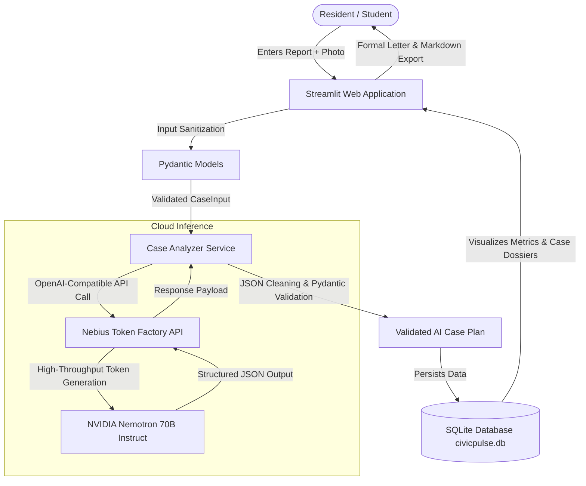

# CivicPulse AI — Grassroots Civic Action Platform
> **Nebius × NVIDIA Global AI Hackathon 2026** | **Track:** Best Apps & Agents

Turning grassroots community grievances and infrastructure defects into structured, prioritized case plans and formal complaint packages powered by **NVIDIA Nemotron** on **Nebius Token Factory**.

---

## 1. Project Purpose & Problem Statement

### The Problem
When citizens encounter local hazards — such as severe road craters outside schools, unlit pedestrian walkways, leaking sewer mains, or overflowing public dumpsters — reporting them to the appropriate authorities is frustrating and ineffective:
- **Reports are vague:** Citizens often submit unstructured blurbs lacking critical dimensions, exact landmarks, or hazard severity details.
- **Wrong jurisdiction:** Citizens rarely know whether an issue falls under the Municipal Corporation, State Public Works, Electricity Board, or Water & Sewerage Authority.
- **No follow-through:** Without formal complaint drafting, evidence checklists, or escalation schedules, grievances get lost in bureaucratic backlog.

### The Solution: CivicPulse AI
CivicPulse AI acts as a dedicated civic case analyst for residents, students, campus administrators, and neighborhood associations:
1. **Factual Triage:** Analyzes raw incident reports, separates stated facts from assumed risks, and recommends an urgency triage level (`Low`, `Medium`, `High`, `Critical`).
2. **Jurisdiction Identification:** Maps the incident to the appropriate municipal or state authority type without inventing fictional officials.
3. **Formal Complaint Drafting:** Generates an authoritative, professionally phrased complaint letter ready to paste into municipal grievance portals.
4. **Actionable Checklists:** Produces evidence checklists (measurements, timestamps, geo-coordinates) and a 7-day escalation protocol.
5. **Persistent Lifecycle Management:** Stores cases in a local SQLite database, allowing users to track status (`Open`, `In Progress`, `Resolved`), append chronological progress notes, and export complete Markdown case dossiers.

---

## 2. Key Features

- **📊 Civic Health Dashboard:** Real-time visibility into open vs. resolved cases, urgency distributions, and category breakdowns with explicit labeling of sample vs. user-generated data.
- **🚀 1-Click Fast-Fill Scenarios:** Preloaded realistic scenarios (Pothole at College Gate, Overflowing Market Dumpster, Unlit Pedestrian Walkway) to demonstrate end-to-end inference in seconds.
- **⚡ Genuine Nebius × NVIDIA Nemotron Integration:** Real-time inference through Nebius Token Factory (`nvidia/Llama-3.1-Nemotron-70B-Instruct`) with strict Pydantic JSON schema validation.
- **📁 Complete Case Management:** Filter by category, urgency, or status; search by keyword; append field notes; and delete cases with confirmation protection.
- **📥 One-Click Export:** Export full case dossiers as clean Markdown files (`.md`) formatted for citizen advocacy.
- **📸 Local Evidence Preservation:** Optional photo attachment securely stored in local project storage.
- **🛡️ Privacy & Advisory Boundaries:** Clear disclosure that AI urgency is an advisory recommendation and that no sensitive identity documents or passwords are collected.

---

## 3. Architecture & Data Flow



---

## 4. Technology Stack

- **Application Framework:** Streamlit (Python 3.11)
- **AI Inference Engine:** Nebius Token Factory API (`https://api.tokenfactory.us-central1.nebius.com/v1/`)
- **Foundation Model:** `nvidia/Llama-3.1-Nemotron-70B-Instruct`
- **Client SDK:** Official OpenAI Python SDK (`openai>=1.30.0`)
- **Data Validation:** Pydantic v2 (`pydantic>=2.7.0`)
- **Local Persistence:** SQLite3
- **Configuration Management:** python-dotenv (`python-dotenv>=1.0.1`)
- **Automated Testing:** pytest (`pytest>=8.2.0`)
- **Styling:** Custom Civic-Tech CSS design system

---

## 5. Local Setup & Windows Quickstart

### Prerequisites
- Windows 10 or 11
- Python 3.11 installed (`python --version`)
- Git installed (`git --version`)

### Step 1: Open Terminal in the Project Directory
```powershell
cd "c:\Users\ay351\OneDrive\Desktop\CivicPulse AI"
```

### Step 2: Create and Activate Virtual Environment
```powershell
python -m venv .venv
.\.venv\Scripts\Activate.ps1
```
*(If PowerShell shows execution policy restrictions, run: `Set-ExecutionPolicy -Scope Process -ExecutionPolicy Bypass`)*

### Step 3: Install Required Packages
```powershell
.\.venv\Scripts\pip install -r requirements.txt
```

### Step 4: Configure Environment Variables
Copy `.env.example` to `.env`:
```powershell
Copy-Item .env.example .env
```
Edit `.env` and insert your Nebius Token Factory API Key:
```ini
NEBIUS_API_KEY=your_actual_nebius_api_key_here
NEBIUS_BASE_URL=https://api.tokenfactory.us-central1.nebius.com/v1/
NEBIUS_MODEL=nvidia/Llama-3.1-Nemotron-70B-Instruct
DATABASE_PATH=civicpulse.db
```

### Step 5: Run Automated Tests
Verify system integrity by running the test suite:
```powershell
.\.venv\Scripts\pytest -v
```

### Step 6: Launch the CivicPulse AI Application
```powershell
.\.venv\Scripts\streamlit run app.py
```
Open your browser at `http://localhost:8501`.

---

## 6. How NVIDIA Nemotron & Nebius Token Factory Are Used

### NVIDIA Nemotron (`nvidia/Llama-3.1-Nemotron-70B-Instruct`)
NVIDIA's Nemotron model family excels at complex reasoning, multi-constraint instruction following, and helpful alignment. In CivicPulse AI, Nemotron is prompted with a dedicated Senior Civic Infrastructure Case Analyst system prompt. It performs:
- **Triage Reasoning:** Synthesizes hazard duration, vulnerable populations (e.g. students, cyclists), and secondary consequences to assess urgency.
- **Epistemic Distinction:** Explicitly distinguishes facts mentioned directly by the user from inferred assumptions.
- **Formal Letter Synthesis:** Converts unstructured citizen complaints into professional, respectful, and authoritative administrative correspondence.

### Nebius Token Factory
Nebius Token Factory hosts high-throughput GPU infrastructure providing OpenAI-compatible endpoints with low latency. CivicPulse AI communicates directly with `https://api.tokenfactory.us-central1.nebius.com/v1/` using the official `openai` Python SDK.

---

## 7. Honest Feedback on Tools Used

### Nebius Token Factory
- **Strengths:** The standard OpenAI-compatible API schema makes integration seamless. Response latencies for 70B models are exceptionally low.
- **Observations:** Clear developer documentation on case-sensitivity of model IDs (`nvidia/Llama-3.1-Nemotron-70B-Instruct`) is crucial to avoid 404 errors during client setup.

### NVIDIA Nemotron
- **Strengths:** Outstanding adherence to complex JSON schemas. Nemotron rarely produces markdown wrapping errors when asked for strict JSON, and its formal complaint letter generation is articulate and legally sound.
- **Observations:** High prompt helpfulness means the model benefits significantly from explicit guardrails preventing it from inventing fictional civil servant names or telephone numbers.

---

## 8. Deployment Guide (Public Demo)

To deploy CivicPulse AI for public evaluation by hackathon judges:

### Option A: Streamlit Community Cloud (Recommended & Free)
1. Push your repository to your personal GitHub account (see GitHub Readiness section below).
2. Visit [share.streamlit.io](https://share.streamlit.io/) and connect your GitHub repository.
3. Set the Main file path to `app.py`.
4. In **Advanced Settings -> Secrets**, add:
   ```toml
   NEBIUS_API_KEY = "your_actual_nebius_api_key_here"
   NEBIUS_BASE_URL = "https://api.tokenfactory.us-central1.nebius.com/v1/"
   NEBIUS_MODEL = "nvidia/Llama-3.1-Nemotron-70B-Instruct"
   ```
5. Deploy. Streamlit Cloud provides a persistent HTTPS URL accessible to judges.

### Option B: Render Web Service
1. Create a `New Web Service` on [Render](https://render.com/).
2. Connect your GitHub repository.
3. Build command: `pip install -r requirements.txt`
4. Start command: `streamlit run app.py --server.port $PORT --server.address 0.0.0.0`
5. Add environment variables `NEBIUS_API_KEY`, `NEBIUS_BASE_URL`, and `NEBIUS_MODEL`.
*Note: Free-tier instances on Render may sleep after inactivity; SQLite storage on Render free tier is ephemeral across redeploys.*

---

## 9. Privacy, Security & Data Boundaries

- **No Secret Leaks:** `.env`, SQLite databases (`*.db`), and uploaded files (`uploads/`) are excluded from version control via `.gitignore`.
- **Zero Raw Credential Exposure:** API keys are never rendered in the UI, application logs, or exported markdown files.
- **Local SQLite Storage:** Citizen reports and notes remain in local storage on the host machine.
- **Advisory AI Guardrails:** CivicPulse AI explicitly reminds users that AI urgency classifications and jurisdictional assignments are advisory tools to facilitate citizen advocacy, not official governmental determinations.

---

## 10. License & Third-Party Attributions

- **License:** Released under the [MIT License](LICENSE).
- **Third-Party Libraries:**
  - `streamlit` (Apache-2.0)
  - `openai` (Apache-2.0)
  - `pydantic` (MIT)
  - `python-dotenv` (BSD-3-Clause)
  - `pandas` (BSD-3-Clause)
  - `altair` (BSD-3-Clause)
  - `pytest` (MIT)
