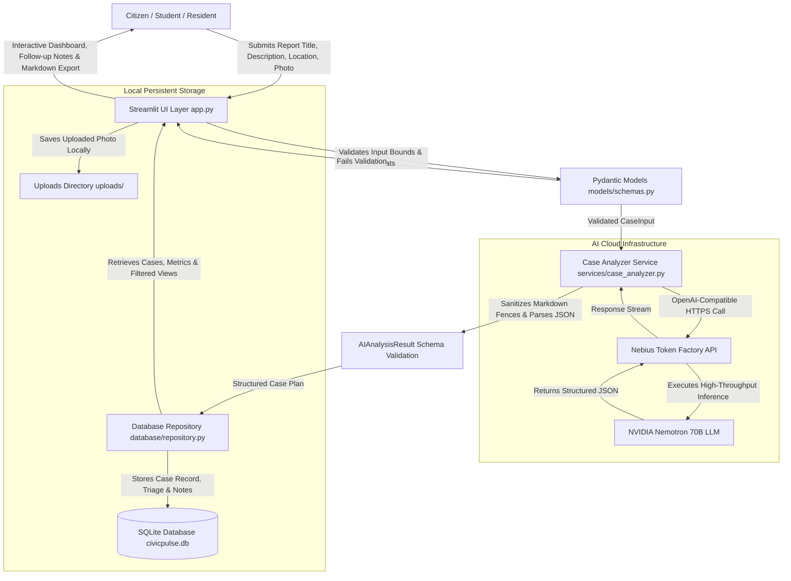

# CivicPulse AI — System Architecture & Workflow

CivicPulse AI is a civic-technology application designed for the **Nebius × NVIDIA Global AI Hackathon 2026** (Best Apps and Agents Track). It bridges the gap between unstructured citizen grievance reports and municipal resolution by transforming raw text and photos into structured, prioritized case plans and formal complaint drafts.

---

## High-Level Architecture Diagram

---

## Runtime Component Breakdown

### 1. Presentation & Interaction Layer (`app.py`, `assets/style.css`)
- Built with **Streamlit** for real-time reactivity and multi-section navigation:
  - **Dashboard:** High-level metrics, urgency distribution, category breakdown, recent case timeline.
  - **Report an Issue:** Input forms with validation, 1-click fast demo scenarios, optional photo attachment.
  - **Case Management:** Status workflow tracking (`Open` -> `In Progress` -> `Resolved`), chronological follow-up notes, Markdown case export, permanent deletion confirmation.
  - **Community Insights:** Aggregated analytics from SQLite data with explicit data provenance labels.
  - **Settings & API Status:** Live Nebius Token Factory `/v1/models` endpoint verification, diagnostics, and session key overrides.

### 2. Validation & Domain Schemas (`models/schemas.py`)
- **`CaseInput`:** Strict boundary checking (minimum length for titles, locations, and descriptions) to prevent low-quality or blank submissions.
- **`AIAnalysisResult`:** Rigid schema ensuring the LLM returns all required civic plan components:
  - Summary and Category
  - Recommended Urgency (`Low`, `Medium`, `High`, `Critical`) with factual rationale
  - Separation of user-provided facts versus inferred assumptions
  - Missing information checklist
  - Recommended next steps
  - Responsible authority type (never invented fictional officials)
  - Formal complaint letter with citizen placeholders
  - Evidence and follow-up checklists
  - Confidence and advisory disclaimer

### 3. AI Service & Nebius Token Factory Integration (`services/`)
- **`services/nebius_client.py`:** Initializes the official OpenAI Python client targeting Nebius Token Factory (`https://api.tokenfactory.us-central1.nebius.com/v1/`). Provides safe connectivity checks without leaking API keys.
- **`services/case_analyzer.py`:** Crafts system prompts instructing the model as a Senior Civic Infrastructure & Public Policy Analyst. Handles JSON fence cleaning, validation against Pydantic models, and actionable error reporting.

### 4. Persistence Layer (`database/repository.py`)
- Local **SQLite** database (`civicpulse.db`) with relational integrity and indices on `category`, `urgency`, `status`, and `case_number`.
- Thread-safe row operations with automatic cascading deletions for case notes.
- Generates memorable, unique case identifiers (e.g. `CP-2026-A1B2`).

---

## Data Flow: From Incident to Action

1. **Citizen Submission:** User describes an issue (e.g., severe road crater outside a campus gate) and optionally attaches a photo.
2. **Schema Sanitization:** Input is checked for length and character requirements.
3. **Nemotron Inference:** The prompt is sent to Nebius Token Factory. The NVIDIA model evaluates hazard severity, separates facts from inferences, and drafts an official complaint letter.
4. **Structured Ingestion:** The JSON output is parsed into a Pydantic object. If the API fails or returns malformed text, clear remediation is provided.
5. **Persistence:** The case is saved to SQLite with a generated Case ID.
6. **Citizen Empowerment:** The citizen receives a copy-paste ready complaint letter, a prioritized checklist of evidence to gather, and follow-up milestones.
